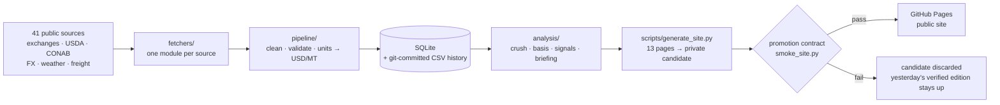

# Mirror Market

[](https://philipbergman6-glitch.github.io/Mirror-Market/)
[](https://github.com/philipbergman6-glitch/Mirror-Market/actions/workflows/deploy-dashboard.yml)

**Public-data soy market intelligence for physical buyers**: 41 free data sources, one SQLite database, a daily-rebuilt static site, and a 4,500-test guard against publishing a wrong number. Python, pandas, Jinja2, GitHub Actions. No paid data, no cloud database, no servers.

| If you have 5 minutes | Look at |
|---|---|
| What it does | the [live site](https://philipbergman6-glitch.github.io/Mirror-Market/) — rebuilt unattended every weekday |
| How it works | [the diagram below](#how-it-works) |
| Why the numbers can be trusted | [How it's tested — and what happens when a test fails](#how-its-tested--and-what-happens-when-a-test-fails) |
| The engineering rules every change must obey | [`CLAUDE.md` → Invariants](CLAUDE.md#invariants--never-break-these) |
| A real audit of the published numbers | [`research/v1-hand-verification-2026-10-17.md`](research/v1-hand-verification-2026-10-17.md) |

## The Big Picture

Every morning, a soybean trader needs to answer one question: **"What moved overnight, and why?"**

Answering it properly means checking dozens of places — futures prices, USDA reports, Brazilian crop estimates, Chinese demand, weather in six continents, currency moves, what big funds are betting. Mirror Market does that checking automatically.

It is three things stacked on top of each other:

1. **A data collector** — a Python script that runs 41 operational data layers (37 numbered source groups plus four independently graded sub-layers) every weekday and saves everything into one database.
2. **An analysis engine** — code that turns that raw data into plain conclusions: "prices are overbought," "Brazil is undercutting US beans," "funds are crowded into this trade."
3. **A morning site** — a headline page plus one page per market, rebuilt daily and published free on GitHub Pages, presented in the order a trader would scan it.

The focus is the **soy complex** — soybeans and the two products they're crushed into, soybean oil and soybean meal — plus the crops that compete with them (corn, palm oil, wheat). All prices are converted to **US dollars per metric ton** so a Chicago price, a Brazilian price, and a South African price can sit on the same chart.

## How it works



Every stage is deterministic Python. **No number on the site is produced by a language model**: each one is fetched from its publisher, parsed by code that is tested against that publisher's real documents, stored with its source and timestamp, and labelled with what kind of price it is.

## How it's tested — and what happens when a test fails

### Where the tests live

- **`tests/`** — 206 test files, **4,511 test cases** (pytest), plus lint (ruff) and type checks (mypy). Line coverage is 88%; a drop below 70% fails the run.
- **`tests/fixtures/`** — real documents captured from the sources: USDA PDFs, CONAB files, SAFEX and CEPEA pages, freight spreadsheets, CFTC files. Parsers are tested against what each publisher actually serves, known-bad files included (`cec_2025-02-27_wrong_formula.pdf` is a real South African crop-estimate release whose column header states the wrong formula).
- **`tests/_guards.py`** — a sandbox around the whole suite: any test that reaches the internet, or writes into the committed history in `data/history/`, fails at the offending line. Tests can't pass by accident against live data.

### What they check

| Area | What a failing test would mean | Examples |
|---|---|---|
| Parsers | a source changed format and we'd misread it | `test_fetcher_*.py` (19 files) |
| Units & FX | a price converted at the wrong rate or unit | `test_units.py`, `test_fx_date_rule.py`, `test_fx_alignment.py` |
| "Nothing invented" | a gap got filled with a made-up number | `test_no_fabricated_closes.py`, `test_settlement_guard.py` |
| One session per spread | a crush mixing two days' prices | `test_named_crush.py`, `test_dce_month_crush.py` |
| Privacy | a desk's positions could reach the public site | `test_book_privacy.py`, `test_workstation_privacy.py`, `test_desk_assumptions_private.py` |
| Site contract | a broken, stale or unsafe page could publish | `test_site_promotion.py`, `test_site_contract.py`, `test_template_injection.py` |
| The docs themselves | this README drifted from the code | `test_docs_claims.py` — the source table below must match the layer roster |

### What happens when something fails

| Gate | When it runs | It fails on | Then |
|---|---|---|---|
| **1. Pull-request CI** (`ci.yml`) | every PR and push | lint, types, any of the 4,511 tests, coverage < 70%, a test that dirtied the repo, a PR that edits `data/history/` | the change can't merge |
| **2. Deploy gate** | every weekday 19:00 UTC — the deploy re-runs gate 1 first | the same checks | nothing is built; the public site keeps the last verified edition; a GitHub issue (`ci-deploy-alert`) opens and emails me |
| **3. Per-source grading** (`main.py`) | every run, every source | a source failed, served stale data, or answered only part of the request | that source is marked failed on every page it feeds; the others still run; a `ci-alert` issue opens, and a `ci-dead-source` issue if it stays down 3 sessions |
| **4. Promotion contract** (`scripts/smoke_site.py --browser`) | before upload | missing benchmarks or briefing, a broken page, bad timestamps, dead links, overflow on mobile or desktop | the candidate is thrown away; yesterday's edition stays public |
| **5. Public smoke** | after deploy | the live URLs don't serve what was promoted | the run is red and the alert issue opens |

Every alert issue closes itself on the next green run. **A wrong number is treated as worse than a missing one**, so every gate fails closed: the site goes quiet or stays on yesterday's edition rather than publishing something unverified.

*A real example:* in November 2026 a test with a hard-coded date expired. Gate 2 blocked every daily build, the public site stayed on its last verified edition, and alert issue [#597](https://github.com/philipbergman6-glitch/Mirror-Market/issues/597) opened. The fix pinned the date so the test can't expire again.

### Checking the numbers, not just the code

Tests prove the code does what it says. Three more checks test the *numbers*:

- **Reconciliation** (`scripts/reconcile_*.py`, every deploy): CBOT benchmarks, required FX pairs and Argentina FOB values go through two independently written ingestion paths, and every field where they disagree is reported.
- **Hand verification against the publishers** ([`research/v1-hand-verification-2026-10-17.md`](research/v1-hand-verification-2026-10-17.md)): 12 published numbers traced back to source documents (CME daily bulletin, USDA AMS, Dalian exchange, CEPEA, Brazil's central bank PTAX, ECB), with the arithmetic shown so anyone can recompute them. The values matched within their stated tolerances (one CNY rate was flagged for follow-up). The real findings were three *labelling* defects: a Dalian crush mixing contract months, and two prices averaged across shipment windows without saying so. Each became a ticket and was fixed.
- **A permanent run record** (`data/history/layer_runs.csv`): every run appends each source's outcome, so reliability is measured from history, not claimed.

### Built with AI agents, gated by machines

Much of this code was written with AI coding agents (Claude Code) working under my direction. That is why the rules are enforced by machines, not trust: the invariants in [`CLAUDE.md`](CLAUDE.md) bind every agent, and an agent's change ships only if it clears the same five gates as mine.

## The Site

**The headline page**, in the order you'd scan it each morning:

**01 The Complex Overnight** — what prices did · **02 What Fired** — anything unusual, ranked by urgency · **03 Propagation** — who has repriced, and who has not printed · **04 Crush Board** — is processing beans profitable · **05 Relative Value** — how soy compares to rivals · **06 Supply & Demand** — how much the world is growing, buying, and holding · **07 Risk Monitor** — currencies, fund positioning, weather · **08 Forward Curves** — what future months cost vs today · **09 Seasonal** — how this year compares to a normal year · **10 Technicals** — deep charts · **11 The Full Briefing** — the whole text report · **12 About the Data** — every source, its age, and whether it printed

Every page carries two clocks: when it was *generated*, and how old the *oldest number feeding the headline* is — so "generated 10:31" can never read as fresher than "priced from data 16 h old".

**One page per market** — CBOT, Dalian, Brazil, Argentina, India, Europe, South Africa, Nigeria — each built from the same nine blocks (local price, propagation ledger, crush margin, basis vs the board, currency, weather, supply & demand, news, players). The market is a parameter, not a code path: a new market is a registry entry, not new code.

Each market page is **tiered from the data every run** — a full page, a brief, or a stub — so a market whose source went dark demotes itself and says so, rather than publishing a confident-looking empty page. The URL never changes with the tier, so yesterday's link never 404s.

**Four cross-market pages**: **Origins** — the same cargo priced at every origin, side by side · **Players** — crushers, exporters and state buyers by market · **Workstation** — contract months, forward curves and an in-page candlestick chart per contract · **Opportunities** — basis and spread screens. The public site shows their public editions; the private desk editions (a buyer's own positions, hedges and assumptions) are built from gitignored files into `data/workspace/` and are never published.

## Where the Data Comes From (all free)

| # | Source | What it provides |
|--:|--------|------------------|
| 1 | Yahoo Finance | Daily prices for 10 commodity futures |
| 2 | USDA NASS* | US harvest sizes and yields |
| 2b | USDA NASS* | Weekly/seasonal crop progress and condition |
| 3 | FRED* | The economic backdrop: dollar strength, inflation, interest rates |
| 4 | CFTC | What big speculators are betting (published weekly) |
| 5 | Open-Meteo | Weather in 19 growing regions across 6 continents |
| 6 | USDA PSD | Global supply and demand, 10 commodities × 28 countries |
| 7 | Yahoo Finance; ECB (CNY) | 10 currency pairs (a weak Brazilian real makes Brazilian beans cheaper) |
| 8 | World Bank | Monthly benchmark prices (palm oil, rapeseed oil) |
| 9 | AKShare | Chinese futures prices — what the biggest soy buyer is paying |
| 10 | USDA FAS* | Weekly US export sales and who bought |
| 11 | Yahoo Finance | Prices for future delivery months |
| 11b | Yahoo Finance | Daily bar history per named contract (feeds the workstation charts) |
| 12 | USDA WASDE | The monthly USDA forecast the whole market trades on |
| 13 | EIA* | Ethanol, biodiesel, diesel — fuel demand for crops |
| 14 | USDA* | How many beans got crushed, how many got shipped |
| 15 | CONAB | Brazil's official crop estimates (their version of the USDA) |
| 15b | CONAB | Weekly Paraná farmgate prices |
| 16 | NCDEX spot · MSAMB | India domestic bean prices: NCDEX polled Indore spot + Maharashtra mandi median |
| 17 | CEPEA/ESALQ | Brazil farm-gate and Paranaguá soy indicators |
| 18 | JSE SAFEX via Grain SA | South Africa's soy futures exchange |
| 19 | AgRural | Soy prices at Brazil's main export port |
| 20 | USDA AMS | Daily US Gulf export bids (CIF NOLA barge) |
| 21 | Argentina MAGyP | Official daily FOB export values, incl. the only free daily sunflower oil benchmark |
| 22 | European Commission | Weekly EU rapeseed FOB assessment |
| 23 | SAGIS | South Africa weekly producer deliveries — the country's physical flow series |
| 24 | SAGIS | South Africa monthly soybean supply & demand balance (incl. crush volume) |
| 25 | Crop Estimates Committee (SA) | South Africa's official monthly crop estimate, with its in-season revision path |
| 26 | USDA AMS Grain Transport Report | Monthly ocean freight, US Gulf and PNW to Japan |
| 26b | USDA AMS Grain Transport Report | Weekly grain vessel lineups at the Gulf and PNW |
| 27 | NOAA NWPS | Mississippi River stage and forecast at Memphis and St. Louis — barge capacity |
| 28 | Argentina INA | Paraná River level at Rosario — draft limits at the world's largest crush hub |
| 29 | US EPA | Renewable Fuel Standard: RIN generation, RIN prices, volume obligations |
| 30 | USDA AMS MARS* | Weekly US processor cash soybean oil and meal |
| 31 | MDIC/SECEX Comex Stat | Brazil's monthly soy, meal and oil exports by destination |
| 32 | SEA India† | Weekly India meal FAS and oil import price legs |
| 33 | SOPA† | India's state-by-state soybean crop estimate |
| 34 | NOAA NHC | Tropical-cyclone forecast tracks — Atlantic and East Pacific ports |
| 35 | JTWC | Tropical-cyclone forecast tracks — West Pacific, Indian Ocean, Southern Hemisphere ports |
| 36 | AFEX (Africa Exchange)‡ | Nigeria's daily soybean reference price — not a settlement |
| 37 | Euronext MiFIR delayed trades + ESMA FIRDS§ | MATIF rapeseed (ECO) last trade by contract month — private desk layer, never published |

\* needs a free API key (`USDA_API_KEY`, `FRED_API_KEY`, `FAS_API_KEY`, `EIA_API_KEY`, `MARS_API_KEY`). **34 of 41 operational layers need no key at all** (Layer 37 needs a desk flag, not a key); `python main.py --doctor` names what each missing key costs. If any one source fails, the rest still run and the degradation stays visible on the page.
† stored and analysed, but the raw table is never published: the publisher's terms allow use, not redistribution. Only derived readings (a year-on-year change, a state share) render.
‡ published by owner decision (2026-11-05) although the exchange's terms reserve redistribution; `config.AFEX_PUBLISH_RAW` withdraws it in one flip.
§ private by owner decision (2026-11-05): Euronext delayed data is free for internal use and licensed for redistribution, so `config.MATIF_PUBLISH` is False and enforced — the table never leaves the desk's database, and the layer runs only where `MATIF_PRIVATE_FETCH` is set (never in CI). Not a settlement: the rows are last on-book trades.

`config.PRODUCTION_LAYERS` is the one roster; this table is checked against it in CI.

## What the Analysis Actually Tells You

In plain terms, each piece answers a question a trader would ask:

- **Technicals** — *"What does the chart say?"* Standard indicators (moving averages, RSI, MACD, Bollinger Bands) that flag momentum and overbought/oversold conditions.
- **Signals** — *"Did anything just change?"* Automatic alerts when indicators cross meaningful lines, ranked by severity so the urgent ones surface first.
- **Crush spread** — *"Is it profitable to process soybeans?"* Beans are bought, crushed, and sold as oil + meal. The spread is the processor's margin — when it's fat, demand for beans rises.
- **Brazil basis** — *"Is Brazil undercutting the US?"* The gap between the price at Brazil's export port and the Chicago benchmark. Brazil is the US's biggest competitor; this gap shows who's winning export business.
- **Stocks-to-use** — *"How tight is supply?"* Leftover inventory as a fraction of yearly consumption. Low number = little cushion = prices react violently to bad news.
- **Positioning z-scores** — *"Is the trade crowded?"* When speculative funds are all leaning the same way to a historically extreme degree, a snap-back gets more likely.
- **Market Drivers** — *"How does it fit together?"* A written narrative connecting the layers: the Brazilian real and exports, fund crowding, weather premiums, dollar impact, China's buying pace.
- **Daily briefing** — the full 30-section text report, archived to the database each day so past calls can be checked against what actually happened.

## Run It Yourself

```bash
pip install -r requirements.txt

python main.py                      # run all 41 operational layers
python main.py --doctor             # which API keys are set, and what a missing one skips (no fetch)
python scripts/generate_site.py     # build the whole site → docs/
python scripts/generate_site.py --only india    # or one page, for the dev loop
python -c "from analysis.briefing import generate_briefing; print(generate_briefing())"   # print today's briefing
```

## Trust — how the numbers are kept honest

Free public data fails in quiet ways. Most of the engineering here is about refusing to publish a wrong number:

- **"Success" requires new rows, not just a 200 OK.** A source that serves last month's file every day is recorded as *failed*, ages out of its freshness window, and says so on every page. Same for a source that answers with nothing, or that answers for only half the keys it was asked for.
- **Half a walk is a wrong number, not a missing one.** India's daily price is a median across ~115 reporting markets — a truncated fetch yields a plausible wrong figure with nothing in its shape marking it partial, so it hard-fails instead.
- **Unsettled prices are dropped, not stored.** A run landing mid-session would otherwise save an unfinished bar as the day's close. The site prints a gap rather than a wrong close.
- **Our outage never reads as the market's silence.** When a page is thin because *our* ingest broke, it says so, with the date of the last good run.
- **A basis says whether trade can actually close it.** India's bean trades ~+66% over Chicago and nothing arbitrages it — GM imports are banned behind a tariff wall — so it renders as a labelled policy spread, never as a tradeable one.
- **A failure is isolated three ways**: a broken block renders an empty state with its reason, a broken page becomes a diagnostic tombstone only inside the private candidate, and a broken headline fails the candidate. A candidate with a tombstone never replaces the last trustworthy public edition.

## Deployment

GitHub Actions runs the whole thing unattended: daily (and on every push to `main`) it collects the data and builds a private candidate. The promotion contract requires current soy-complex benchmarks, a generated briefing, aligned required calculations, all expected pages without tombstones, valid timestamps, layer counts consistent with the `config.PRODUCTION_LAYERS` roster, valid internal links, and overflow-free desktop/mobile rendering. Only a passing candidate is uploaded to GitHub Pages; otherwise the previous trustworthy edition remains public. A second smoke test reads the deployed public URLs. The schedule targets a landing window after Chicago settlement, while settlement and freshness guards enforce correctness independently of cron timing. Snapshot-only observations and operational freshness state round-trip through committed CSVs so an ephemeral runner retains both history and the age of the last known good run.

<details>
<summary>Trusted static preview (operator commands)</summary>

To preview a verified or candidate trust edition without changing the public dashboard, render it into a candidate directory first:

```bash
.venv/bin/python scripts/publish_trusted_static.py \
  --trust-repository data/v2 \
  --edition-id edn_... \
  --candidate-root build/trusted-static-candidates
```

By default this writes `build/trusted-static-candidates/<edition-id>/` and prints a JSON summary. It does not mutate `docs/`.

Only publish the rendered candidate explicitly:

```bash
.venv/bin/python scripts/publish_trusted_static.py \
  --trust-repository data/v2 \
  --edition-id edn_... \
  --candidate-root build/trusted-static-candidates \
  --deploy \
  --public-dir docs
```

</details>

## How the Code Is Organized

```
main.py            runs the whole collection pipeline, source by source
config.py          every threshold, the layer roster, the market registry — numbers live here, not in code
fetchers/          one module per data source (the "collectors")
pipeline/          cleaning, validation, unit conversion, database read/write, git-CSV history
pricing/           the one price vocabulary: what a number is, how confident, which FX date
analysis/          turns stored data into indicators, signals, hazards, and the briefing
app/               the market registry, the block builders, and the HTML templates
trust/             source contracts, the promotion gate, reconciliation ledger
scripts/           generate_site.py — the orchestrator that renders every page
tests/             4,511 tests + real source fixtures; sandboxed — no network, no writes to history
docs/              local site output (gitignored) — Pages serves the CI-built artifact, not this directory
```

Design system in `DESIGN.md` · architecture and the capability-status table in `ARCHITECTURE.md` · every source's traps in `LAYERS.md` · engineering invariants in `CLAUDE.md` · what is deliberately deferred in `ROADMAP.md` · working on it with an AI agent starts at `AGENTS.md`.

---

*A project by Philip Bergman. Free public data, delayed, provided as-is — not financial advice.*
